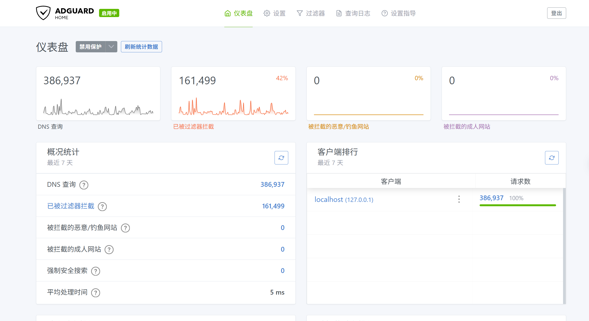
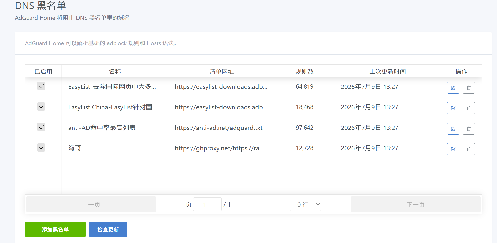

### 由刘淳本人整理的拦截规则和放行规则使用于AdGuardHome，adblock格式
本人整理的清单加上海哥的清单和anti-AD命中率最高列表，拦截效果很不错，既不一刀切又放行了误拦截重要的静态资源、图片cdn域名等
相关的清单链接如下：

<div style="border:3px soild black;padding:14px;">
  
1、[anti-ad](https://anti-ad.net/adguard.txt)
```
https://anti-ad.net/adguard.txt
```
2、[海哥的清单](https://ghproxy.net/https://raw.githubusercontent.com/2771936993/HG/main/hg1.txt) 
```
https://ghproxy.net/https://raw.githubusercontent.com/2771936993/HG/main/hg1.txt
```
3、[刘淳的拦截清单](https://ghproxy.net/https://raw.githubusercontent.com/GXLCLC/Ad-blocking-list/refs/heads/main/adlist)
```
https://ghproxy.net/https://raw.githubusercontent.com/GXLCLC/Ad-blocking-list/refs/heads/main/adlist
```
</div>

## 如图所示
---
图一

图二


